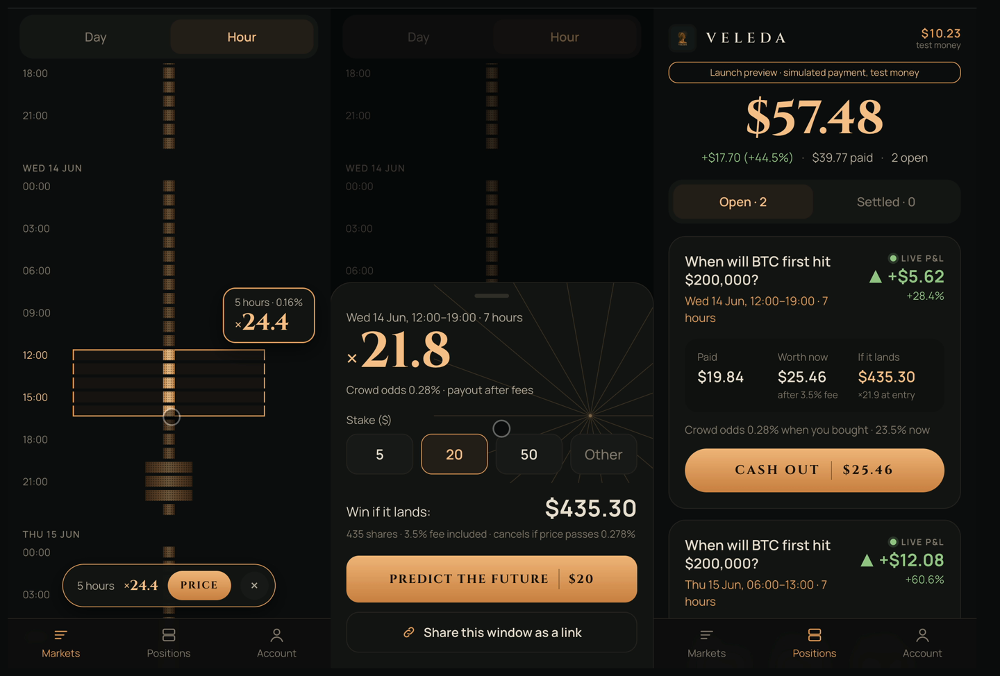

# Veleda

**Fans argue about *when* things will happen. Veleda, the market of seers, turns those arguments into calls you can stake, share and get credit for.** Buy any window of future time, from an hour to a year, in one trade, and cash out at the live price whenever the crowd moves your way.

A prototype for the Encode Club Solana Hackathon (from 12 October 2026), "Best Consumer App on Solana" track, running on Solana devnet with a test currency, Veleda Credit (VCR).

- **Live app:** https://veleda-veleda1.vercel.app (sign in with email or Google; new accounts get 100 VCR of test money)
- **Launch preview:** https://veleda-veleda1.vercel.app/?preview=launch shows the real-money flow as it would work at launch: new accounts start at $0 and add money through a simulated payment, with balances shown in dollars. Still test money on devnet.
- **Practice mode:** https://veleda-veleda1.vercel.app/practice, a scripted market on a fictional event that you scrub forwards and backwards. Same maths as the live markets, with no sign-in and nothing on chain.
- **Demo video:** _link added at submission_
- **Program (devnet):** `7be7tgXwK46Yu9AWqes8g5FBvBjjBqvxJFVhP1io37hx`
- **VCR mint (devnet):** `CjkpwuK5BU8sC4vhAgvnGLFg1QAf4xLNxiRKesMEfXaP`



## How Solana powers Veleda

Every Veleda market is a single on-chain automated market maker, a logarithmic market scoring rule (LMSR), that prices the whole timeline at once. The timeline is split into hourly or daily slots, and the prices for every slot live in a segment tree inside one zero-copy account. Buying a window means adding shares to every slot in that range. The tree applies this as a lazy range-multiply: each node stores the total weight beneath it, so a window is covered by a few whole nodes, which are multiplied and tagged rather than visiting every slot. Any trade touches a small number of nodes whether the window is one hour or one year, so cost barely depends on width (on the live three-year market, about 70K compute units for a 1-day window and 100K for 700 days), and a single program instruction can quote, buy or sell any contiguous range atomically.

Because the AMM is always on the other side of the trade, there's no order book and no waiting for a counterparty. You can enter early at a long-shot price and cash out at the live price at any time. The maths runs in Q64.64 fixed point, with costs rounded up and proceeds rounded down. Every instruction checks one invariant: the vault always holds enough to pay the largest possible payout, so every position is fully backed on-chain.

Solana's low fees and fast finality make small, precise calls practical, such as 5 VCR on a single day. Embedded wallets (Privy) plus a platform fee payer let new users sign in with email and place their first call in under 60 seconds, with no SOL, seed phrase or wallet install.

## Repository layout

| Path | What it is |
| --- | --- |
| `programs/veleda` | Anchor program: `create_market`, `buy_range`, `sell_range`, `advance_time`, `resolve`, `claim`, `set_clock_offset`. LiteSVM tests in `tests/` |
| `crates/veleda-math` | `no_std` Rust maths (Q64.64 fixed point, packed floats, LMSR, segment tree) and the market engine the program runs |
| `packages/reference` | TypeScript f64 reference model of the market maths, used to cross-check the Rust engine |
| `app/` | Next.js web app and fee-payer server: Privy sign-in, sign-up airdrop, trade routes, timeline UI |
| `scripts/` | One-command setup (`setup.sh`, `setup.ts`), market creation, admin tools, trader bots, token metadata, cross-check |
| `.github/workflows/bots.yml` | Runs a round of trader bots every 30 minutes |
| `markets.json` | Addresses of the live devnet markets (read by the app and bots) |
| `docs/`, `design/` | Project brief, specs, build plan, mockups and design tokens |

## Setup

### Quick start (Node only)

You need Node.js 23.6 or later and a free [Privy](https://privy.io) app with Solana embedded wallets and email or Google sign-in enabled.

```
git clone <this repo> veleda && cd veleda
npm run setup
```

`npm run setup` installs both projects, creates your own devnet keys in `keys/`, gets devnet SOL, creates your own test-money mint ("Veleda Credit", VCR), creates both demo markets on the already deployed program, writes their addresses to `markets.json`, adds `TOKEN_MINT` to `.env` and runs one round of trader bots. It needs about 1.6 devnet SOL. If the faucet rate-limits, it prints one address to fund at https://faucet.solana.com: fund it and run `npm run setup` again, and it carries on where it stopped. Re-running is always safe.

Then put your Privy keys in `.env` (setup adds empty lines for them), add `http://localhost:3000` to the Privy app's allowed origins, and start the app:

```
cd app && npm run dev           # http://localhost:3000
```

New accounts get 100 VCR from your mint, and every trade, cash-out and claim runs on devnet against your markets.

**Your own program as well:** `npm run setup -- --own` also needs Rust 1.99, Solana CLI 3.1 (Agave) and Anchor CLI 1.1 (via `avm`), and about 6 more devnet SOL. It creates a program key, puts its address in the four files listed under step 4, builds the program and deploys it, then carries on as above.

The sections below are what the setup does, for doing it by hand.

### Prerequisites

- Node.js 23.6 or later (scripts are TypeScript run directly by Node)
- For the program and maths only: Rust 1.99, Solana CLI 3.1 (Agave), Anchor CLI 1.1 (via `avm`)
- A free [Privy](https://privy.io) app with Solana embedded wallets and email/Google sign-in enabled

### 1. Install

```
git clone <this repo> veleda && cd veleda
npm ci                     # root: reference model and scripts
(cd app && npm ci)         # the web app has its own node_modules
```

### 2. Keys and environment

Devnet keypairs live in `keys/` (gitignored, never committed). Create them with `solana-keygen new -o keys/<name>.json`:

| File | Role |
| --- | --- |
| `admin.json` | Program upgrade authority and market admin; pays for market creation |
| `fee-payer.json` | Pays users' transaction fees and position rent |
| `mint-authority.json` | Mints VCR for market subsidies, sign-up airdrops and bots |
| `token-mint.json` | The VCR mint address |
| `veleda-program.json` | The program address |
| `bot-payer.json` | Pays the trader bots' fees and rent (bot wallets go in `keys/bots/`, created on first run) |

Fund `admin.json`, `fee-payer.json` and `bot-payer.json` with devnet SOL (`solana airdrop 2 <address> -u devnet`, or a faucet).

Create a `.env` in the repo root (read by the app and the scripts):

```
NEXT_PUBLIC_PRIVY_APP_ID=...    # from the Privy dashboard
PRIVY_APP_SECRET=...
SOLANA_RPC_URL=...              # optional; defaults to the public devnet RPC, which rate-limits
TOKEN_MINT=...                  # optional; defaults to the VCR mint above
```

### 3. Run the web app

The app reads the markets in `markets.json`. The ones committed here are the live demo markets, which use the maintainers' VCR mint; to trade from your own server you need your own mint and markets (step 4, or `npm run setup`), because the sign-up airdrop mints VCR.

```
cd app && npm run dev           # http://localhost:3000
```

Add `http://localhost:3000` to your Privy app's allowed origins.

### 4. Deploy your own program and markets (optional)

```
anchor build
anchor deploy --provider.cluster devnet
spl-token create-token keys/token-mint.json --decimals 6 \
  --mint-authority $(solana-keygen pubkey keys/mint-authority.json) --fee-payer keys/admin.json -u devnet
node scripts/set-token-metadata.ts             # names the mint "Veleda Credit" (VCR)
node scripts/create-markets.ts flagship fast   # creates both markets, funds their vaults, writes markets.json
node scripts/bots.ts                           # trader bots: a round every ~2 minutes until stopped
```

If you deploy your own program, update its address in `Anchor.toml`, `programs/veleda/src/lib.rs` (`declare_id!`), `scripts/lib/veleda.ts` and `app/src/lib/veleda/program.ts`, and set `TOKEN_MINT` in `.env`.

Run a demo market by hand with the admin key:

```
node scripts/admin.ts fast status
node scripts/admin.ts fast clock +3h        # move the fast market's clock forward
node scripts/admin.ts fast advance          # prune elapsed time
node scripts/admin.ts fast resolve <atom|ISO time|end>
```

### Deploying the app

The live app is on Vercel's free tier: root directory `app`, Node 24, with files outside `app/` included (practice mode imports `packages/reference`). Without `keys/` and `markets.json`, the server reads `FEE_PAYER_KEY`, `MINT_AUTHORITY_KEY` (keypairs as JSON arrays) and `MARKETS_JSON` from the environment, alongside the two Privy variables.

## Tests

```
npm test                                   # TypeScript reference model
cargo test -p veleda-math                  # Rust maths and engine
scripts/cross-check.sh                     # replay 15,000 random reference-model actions through the Rust engine
anchor build && cargo test -p veleda       # program tests in LiteSVM (load target/deploy/veleda.so)
```
